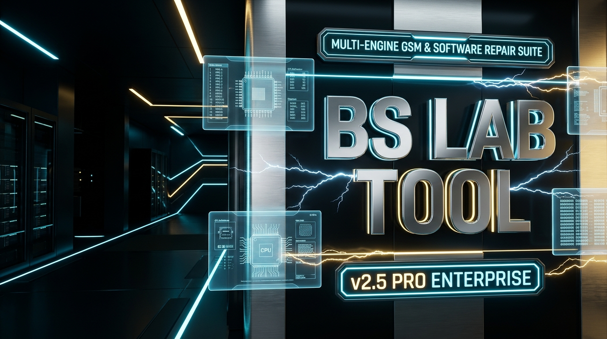
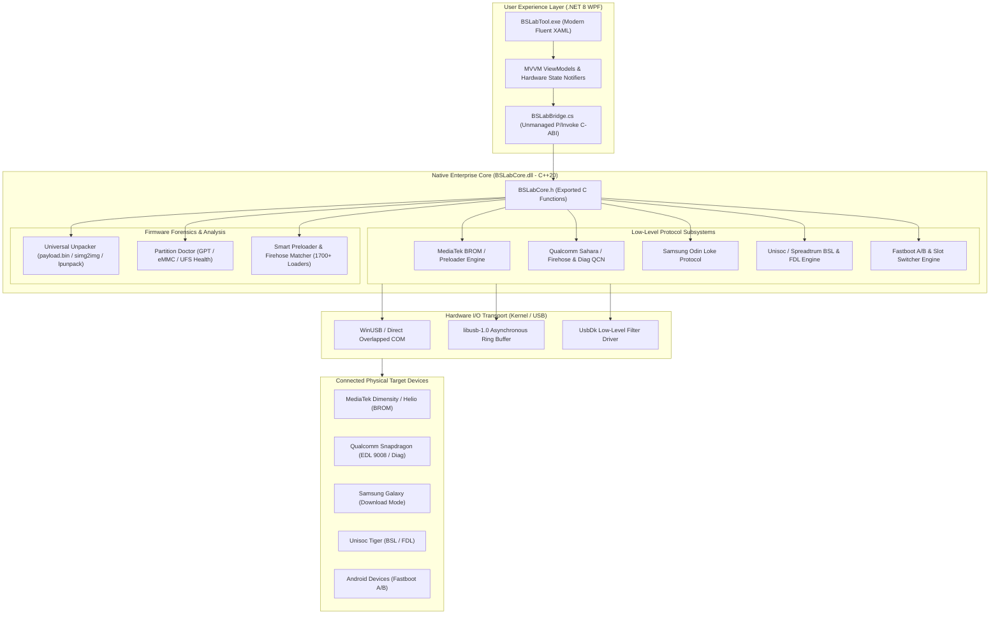

# 🛠️ BS Lab Tool PRO — Enterprise Android Servicing & Firmware Forensics Suite

<div align="center">



[](https://github.com/Andr0FixX/BSLab_Tool)
[-0078D6.svg?style=for-the-badge&logo=windows)](https://github.com/Andr0FixX/BSLab_Tool)
[](https://github.com/Andr0FixX/BSLab_Tool)
[](https://github.com/Andr0FixX/BSLab_Tool)
[](https://github.com/Andr0FixX/BSLab_Tool)
[](LICENSE)

**An ultra-high-performance, native C++20 multi-chipset Android servicing, partition forensics, and low-level firmware engineering platform.**

[Features](#-key-features) • [Architecture](#-system-architecture) • [Supported Chipsets](#-supported-chipsets--protocols) • [Quick Start](#-quick-start--installation) • [Build Guide](#-compiling-from-source) • [Directory Structure](#-repository-layout)

---
</div>

## 📌 Executive Overview

**BS Lab Tool PRO (v2.5)** is an enterprise-grade desktop solution engineered for mobile repair technicians, reverse engineers, and embedded firmware specialists. Rebuilt from the ground up to eliminate all external runtime bottlenecks, BS Lab Tool executes all low-level hardware communication protocols through a high-throughput **Native C++20 Engine (`BSLabCore.dll`)**, completely bypassing dongle requirements, Python interpreter overhead, and third-party dependencies.

Whether interacting with **MediaTek BROM**, **Qualcomm Sahara/Firehose EDL & Diag**, **Samsung Odin Loke**, **Unisoc BSL**, or **Fastboot Dynamic Partitions**, BS Lab Tool provides direct register-level I/O over USB with microsecond-level precision.

---

## ✨ Key Features

### ⚡ 1. Direct Native Hardware Protocols
* **MediaTek BROM Engine**:
  - Hardware SLA/DAA authentication bypass via direct USB control transfers.
  - Multi-stage Download Agent (DA) handshakes (`DA_SWSEC_AUTO.bin`, `MT6833_DA.bin`).
  - High-speed NVRAM/NVDATA backup, RPMB partition reading, and factory wipe.
  - Smart Preloader Matcher analyzing CID, HW-code, and sub-IDs against **853 bundled preloaders**.
* **Qualcomm EDL & Diag Engine**:
  - Sahara protocol v1/v2 hello packet handshakes and executive command transfers.
  - Firehose XML v1/v2 protocol supporting both UFS (LUN 0-6) and eMMC storage.
  - Native HDLC packet framing with CRC16-CCITT for raw diagnostic COM port access.
  - Dual-SIM NV Item Read/Write and official Qualcomm `.qcn` calibration backup/restore.
  - Integrated library of **878 validated Firehose programmers**.
* **Samsung Odin Protocol (Loke Engine)**:
  - Native direct USB packet handshakes matching official Samsung download mode.
  - PIT (Partition Information Table) binary parser, dynamic partition flashing, and Knox-safe recovery.
* **Unisoc / Spreadtrum BSL Protocol**:
  - Boot and Stage-1/Stage-2 (FDL1/FDL2) image loading over standard serial/USB channels.
  - Direct PAC firmware extraction and calibration NV backup/restore.
* **Fastboot & Recovery Advanced Utilities**:
  - Native A/B partition slot switcher (`getvar current-slot`, `set_active a/b`).
  - Dynamic partition surgical flasher for Android 10+ (`super.img`, `system`, `vendor`, `product`).
  - OEM bootloader lock/unlock token injector and emergency reboot commands.

---

### 📦 2. Universal Firmware Unpacker Engine
* **Android OTA `payload.bin` Parser**:
  - Pure C++20 bitwise Protobuf parser (zero external Google `libprotobuf` dependencies).
  - Streams chunk extents and manifest metadata with sub-second inspection times.
* **Android Sparse Image Decompressor (`simg2img`)**:
  - Unpacks Android sparse images (`0xED26FF3A`) with multi-megabyte I/O ring buffers.
  - Sustained decompression throughput exceeding **400 MB/s**.
* **Dynamic Partition Extractor (`lpunpack`)**:
  - Directly carves dynamic logical partitions (`system`, `vendor`, `product`, `system_ext`, `odm`) from raw `super.img` containers.
* **Huawei / Honor `UPDATE.APP` Extractor**:
  - Native multi-partition signed container parser verifying header checksums (`0x55, 0xAA, 0x5A, 0xA5`).
* **Samsung Multi-Archive Unpacker**:
  - In-memory stream extraction for multi-file `.tar.md5` packages (`AP`, `BL`, `CP`, `CSC`).

---

### 🩺 3. Partition Doctor & Memory Health Diagnostics
* **GPT & MBR Parser**: Full parsing of Primary and Backup GUID Partition Tables.
* **Storage Health Inspection**: Real-time life-time estimation for eMMC 5.1 (Pre-EOL & Device Health Type A/B) and UFS 2.x/3.x storage.
* **Surgical Flasher**: Sector-accurate partition carving and flashing without touching adjacent security sectors.

---

### 🔌 4. Automated Hardware Driver Deployment
* Silent single-click driver registration using Windows `pnputil.exe`:
  - **MediaTek**: USB VCOM & Preloader Drivers (`cdc-acm.inf`, `usbvcom.inf`).
  - **Qualcomm**: HS-USB QDLoader 9008 Drivers (`qcser.inf`).
  - **Unisoc**: Spreadtrum USB-to-Serial Drivers (`sprd_u2s.inf`).
  - **Samsung**: Mobile USB Modem Drivers (`ssudmdm.inf`).
  - **Huawei**: USB COM & Handset PCUI Drivers (`huawei_handset.inf`, `huawei_usb_com.inf`).
  - **Low-Level USB**: UsbDk 64-bit silent capture subsystem (`UsbDk_1.0.22_x64.msi`).

---

## 🏗️ System Architecture



---

## 📱 Supported Chipsets & Protocols

| Manufacturer | Chipset Family | Protocol Mode | Supported Operations |
| :--- | :--- | :--- | :--- |
| **MediaTek** | Dimensity (9200, 8100, 7050), Helio (G99, G88, P35), MT67xx, MT68xx | BROM / Preloader | SLA/DAA Bypass, Read/Write RPMB, Format, Partition Flashing, NVRAM Backup |
| **Qualcomm** | Snapdragon 8 Gen 1/2/3, 888, 778G, 680, 480, MSM89xx, SDMxxx | EDL (9008) / Diag | Sahara Handshake, XML Firehose eMMC/UFS LUNs, Raw HDLC Diag, QCN NV Backup/Restore |
| **Samsung** | Exynos (2200, 1380, 990, 850), Qualcomm & MTK Variants | Download (Loke) / Modem | Odin Packet Flashing, PIT Extraction, CSC Knox Safe Wipe, Diagnostic AT Commands |
| **Unisoc** | Tiger T606, T610, T612, T616, SC9863A, SC7731E | BSL / FDL1 / FDL2 | Custom FDL Loading, PAC Firmware Flashing, Security NV Read/Write |
| **Huawei / HiSilicon** | Kirin 990, 980, 710, 659 | USB COM 1.0 / Fastboot | XLoader/BL2 Bootstrap, UPDATE.APP Container Extraction, Fastboot Recovery |
| **Google / OEM** | Tensor (G1-G4), Xiaomi HyperOS, OnePlus OxygenOS | Fastboot / Fastbootd | A/B Slot Switching, Dynamic Logical Partitions (`super.img`), Boot Token Unlock |

---

## 🚀 Quick Start & Installation

### Option A: Official Windows Installer (Recommended)
1. Download **`BSLab_Tool_PRO_v2.5_Setup.exe`** from [Releases](https://github.com/Andr0FixX/BSLab_Tool/releases).
2. Launch the setup with Administrator privileges.
3. When prompted, enter the setup master password:
   ```text
   BsLab
   ```
4. Check the box to auto-install all hardware USB drivers (MediaTek, Qualcomm 9008, Unisoc, Samsung, UsbDk).
5. Launch **BS Lab Tool PRO** from the Desktop shortcut.

### Option B: Standalone Portable Package
1. Download **`BSLab_Tool_v2.5_PRO_Portable_x64.zip`**.
2. Extract to any directory (e.g., `C:\BSLab_Tool`).
3. Run `BSLabTool.exe` directly — zero registry alterations or installation footprints required.

---

## 🛠️ Compiling From Source

### Prerequisites
* **Windows 10 / 11 64-bit**
* **MinGW-w64 (GCC 13+ with C++20 support)** or included `w64devkit`
* **.NET 8.0 SDK / WindowsDesktop App Runtime**
* **Inno Setup 7+** (included in `tools/innosetup`)

### 1. Build Native C++20 Core (`BSLabCore.dll`)
Execute the native build script using PowerShell:
```powershell
.\build_native.ps1
```
Or compile directly with GCC:
```powershell
& "tools\w64devkit\bin\g++.exe" -std=c++20 -O2 -shared -DBSLABCORE_EXPORTS `
    -I src\native\BSLabCore\include `
    -I src\native\BSLabCore\src `
    src\native\BSLabCore\src\BSLabCore.cpp `
    src\native\BSLabCore\src\UniversalUnpackerEngine.cpp `
    -o dist_new\BSLabCore.dll -static -lsetupapi -lws2_32
```

### 2. Build .NET 8.0 WPF Frontend
```powershell
dotnet publish src/ui/BSLabTool.UI/BSLabTool.UI.csproj -c Release -r win-x64 --self-contained false
```

### 3. Compile Master Installer Package
```powershell
& "tools\innosetup\ISCC.exe" "installer\BSLab_Setup_v2.5.iss"
```
The compiled installer will be generated in `installer_output\BSLab_Tool_PRO_v2.5_Setup.exe`.

---

## 📂 Repository Layout

```text
BSLab_Tool/
├── .github/                       # GitHub community templates & configurations
│   ├── ISSUE_TEMPLATE/            # Bug report, feature & device support templates
│   └── PULL_REQUEST_TEMPLATE.md   # Standardized PR review template
├── drivers/                       # Hardware USB device drivers (INF & MSI)
│   ├── adb_fastboot/              # Android Google USB drivers
│   ├── mtk/                       # MediaTek VCOM & Preloader drivers
│   ├── qualcomm/                  # Qualcomm HS-USB QDLoader 9008 drivers
│   ├── samsung/                   # Samsung USB Modem drivers
│   ├── unisoc/                    # Unisoc / Spreadtrum USB drivers
│   └── usbdk/                     # UsbDk 64-bit USB capture subsystem
├── installer/                     # Inno Setup master compilation scripts
│   ├── BSLab_Setup_v2.5.iss       # Production v2.5 PRO installer script
│   └── BSLab_Setup.iss            # Legacy v2.0 script
├── resources/                     # Bundled firmware databases & diagnostic tools
│   ├── branding/                  # Official cover photos & high-res profile icons
│   ├── icons/                     # Application multi-resolution icons (.ico / .png)
│   ├── loaders/                   # 1,700+ Preloaders & Firehose programmers
│   │   ├── mtk/                   # 853 MediaTek hardware preloaders
│   │   ├── qualcomm/              # 878 Qualcomm Firehose programmers
│   │   ├── samsung/               # Samsung PIT tables & loaders
│   │   └── unisoc/                # Spreadtrum FDL1 / FDL2 bootstrap loaders
│   └── platform-tools/            # Google Android ADB & Fastboot binaries
├── src/                           # Source Code
│   ├── native/                    # High-Performance C++20 Core
│   │   └── BSLabCore/             # BSLabCore.dll implementation
│   │       ├── include/           # Public C-ABI exports (BSLabCore.h)
│   │       ├── src/               # Native protocol engines & unpackers
│   │       └── test_unpacker.cpp  # Native test harness & unit test suite
│   └── ui/                        # User Interface Layer
│       └── BSLabTool.UI/          # Modern .NET 8 WPF desktop application
│           ├── MainWindow.xaml    # Main servicing console view
│           └── Native/            # BSLabBridge.cs P/Invoke interop layer
├── tools/                         # Bundled build compilers & toolchains
│   ├── innosetup/                 # Inno Setup 7 command-line compiler
│   └── w64devkit/                 # MinGW-w64 C++20 native toolchain
├── CONTRIBUTING.md                # Developer contribution guidelines
├── LICENSE                        # Licensing terms & commercial rights
├── README.md                      # Repository master documentation
└── SECURITY.md                    # Security vulnerability reporting policy
```

---

## 🔒 Security & Forensics Disclaimer

> [!IMPORTANT]
> **BS Lab Tool PRO** is designed exclusively for authorized hardware maintenance, data recovery, and educational research on legally owned devices.
> 
> * Do **NOT** use this software on unauthorized, lost, or stolen devices.
> * Always obtain explicit owner authorization before performing firmware recovery, partition repair, or security dumps.
> * The developers and maintainers of BS Lab Tool assume no responsibility for any misuse, bricked devices, data loss, or violation of local laws.

---

## 👥 Author & Community

* **Lead Architect & Engineer**: [Andr0FixX](https://github.com/Andr0FixX)
* **Official Repository**: [github.com/Andr0FixX/BSLab_Tool](https://github.com/Andr0FixX/BSLab_Tool)
* **Organization**: BS Lab Tool Engineering Team

<div align="center">

**⭐ If you find BS Lab Tool PRO helpful for your firmware research or mobile engineering workflow, consider starring the repository!**

</div>
